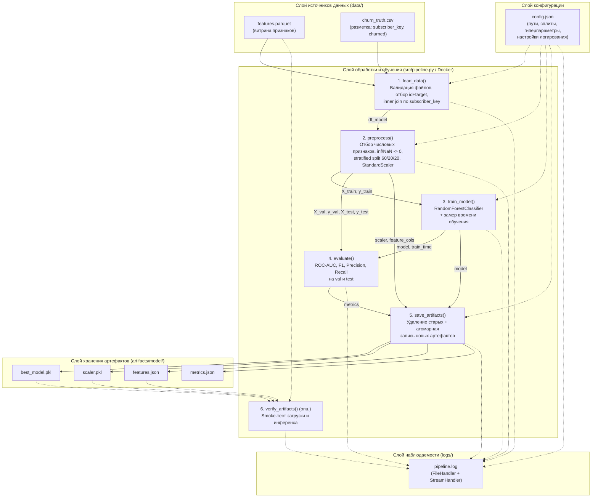

# Архитектура ML-конвейера прогнозирования оттока

Графическая версия схемы также доступна в файле [architecture.png](architecture.png).

## Схема конвейера

## Слои и зависимости между этапами

| Слой | Компоненты | Входы | Выходы / Хранилище |
|---|---|---|---|
| **Конфигурация** | `config.json` | Параметры запуска | Управляет всеми этапами конвейера без правки кода |
| **Источники данных** | `features.parquet`, `churn_truth.csv` | Внешняя выгрузка | `data/` (монтируется в Docker в режиме `read-only`) |
| **Загрузка данных** | `load_data()` | Пути и имена ключевых колонок из `config.json` | Объединённый `DataFrame` (`df_model`) без служебных колонок разметки |
| **Препроцессинг** | `preprocess()` | `df_model`, параметры `preprocessing` | `X_train/val/test`, `y_train/val/test`, `feature_cols`, обученный `StandardScaler` |
| **Обучение** | `train_model()` | `X_train`, `y_train`, гиперпараметры `model` | Обученный `RandomForestClassifier`, `train_time_sec` |
| **Оценка качества** | `evaluate()` | `model`, `X_val/test`, `y_val/test` | Словарь метрик `metrics` (ROC-AUC, F1, Precision, Recall) |
| **Хранение артефактов** | `save_artifacts()` | `model`, `scaler`, `feature_cols`, `metrics` | `artifacts/model/{best_model.pkl, scaler.pkl, features.json, metrics.json}` |
| **Наблюдаемость** | `setup_logging()` | Секция `logging` в `config.json` | `logs/pipeline.log` и вывод в `stdout` |
